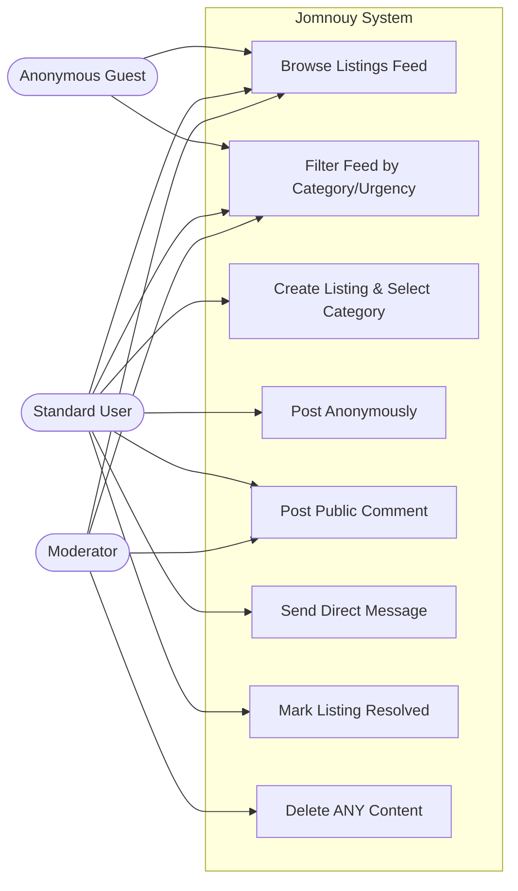
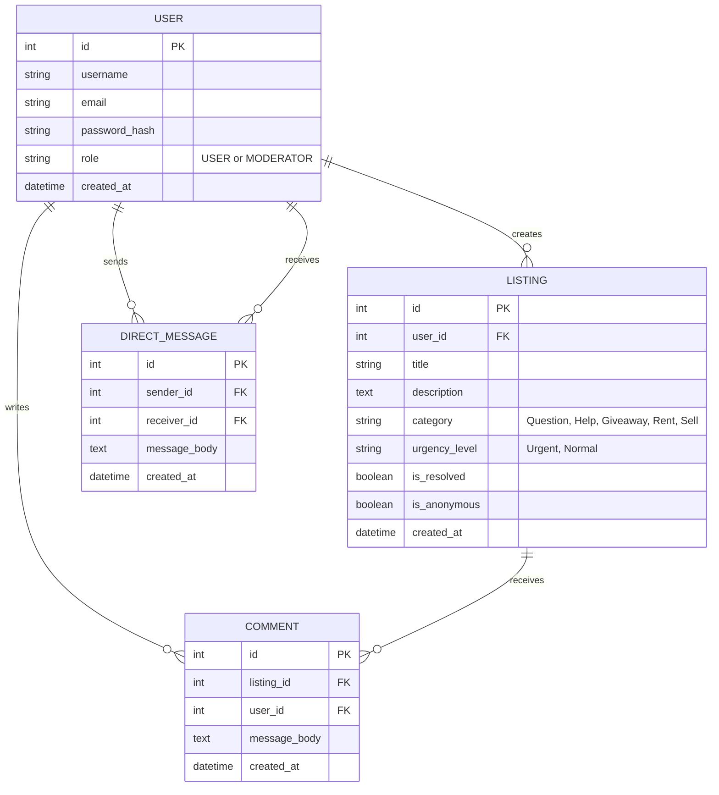

# Software Requirements Specification: Jomnouy

**Prepared for:** Institute of Technology of Cambodia  
**Date:** October 20, 2026  

---

## 1. Introduction

### 1.1 Purpose
The purpose of this Software Requirements Specification (SRS) is to detail the technical, functional, and non-functional requirements for "Jomnouy" (meaning "helper" in Khmer). This document serves as the authoritative blueprint for the development, deployment, and testing of the application over the course of the 14-week individual project timeline. 

### 1.2 Scope
Jomnouy is a full-stack, community-driven web application designed to facilitate mutual aid, local borrowing, and the exchange of second-hand goods. The system operates as a digital bulletin board utilizing five strict categories: **Question, Help, Giveaway, Rent, and Sell**. 

To maintain a focused scope and adhere to the project timeline, the system strictly prohibits native in-app monetary transactions. Instead, users coordinate rentals or sales manually via a built-in direct messaging inbox. The scope encompasses a Vue 3 Single Page Application (SPA), a NestJS backend REST API, and a PostgreSQL database managed by Prisma.

### 1.3 Intended Audience and Reading Suggestions
This document is intended for the course instructor evaluating the project milestones, the defense panel assessing the final architecture, and the developer building the system. Readers interested in the high-level goals should review Section 2. Readers concerned with grading metrics, API design, and database architecture should focus on Sections 3 and 4.

### 1.4 Definitions, Acronyms, and Abbreviations
* **CRUD:** Create, Read, Update, Delete.
* **JWT:** JSON Web Token (used for secure, stateless user authentication).
* **Listing:** A user-generated bulletin post categorized into one of five predefined types.
* **Simple Inbox:** A direct messaging system utilizing standard HTTP REST requests rather than real-time WebSockets.
* **Stretch Feature:** An advanced technical requirement (Search, Filter, Pagination) that accounts for a specific portion of the final grade.

### 1.5 References
1. Chun, T. (2026). *Individual Project Guideline*. Institute of Technology of Cambodia.
2. Vue.js Core Team. *Vue.js 3 Documentation*.
3. NestJS. *NestJS Official Documentation*.
4. PostgreSQL Global Development Group. *PostgreSQL Documentation*.
5. Jelvix. *Software Requirements Specification: Structure and AI Fit*.

---

## 2. Overall Description

### 2.1 Product Perspective
Jomnouy is a newly developed, standalone web application implementing a modern three-tier architecture. The presentation tier is a Vue 3 SPA utilizing Pinia for state management. This frontend consumes a NestJS application tier via REST API endpoints. Data persistence is handled by a PostgreSQL data tier. 

#### System Use Case Diagram

### 2.2 Product Functions
* **Account Management:** Secure registration and JWT login.
* **Categorized Listings:** Users can post under five distinct tags: Question, Help, Giveaway, Rent, Sell.
* **Anonymous Posting:** Users can hide their username when posting sensitive questions.
* **Direct Messaging:** A private inbox for users to coordinate physical meetups safely off-feed.
* **Public Comments:** Open threads on listings for community discussion.

### 2.3 User Classes and Characteristics
| User Class | Characteristics & Privileges |
| :--- | :--- |
| **Standard User** | Authenticated members. Can execute CRUD operations exclusively on their own Listings, Comments, and Messages based on ownership validation matching their JWT. |
| **Moderator** | Administrative accounts. Possess all User privileges plus the ability to delete *any* listing or comment to prevent commercial spam. |
| **Anonymous Guest** | Unauthenticated traffic. Can read the main feed but are blocked by API route guards from viewing private details or executing POST requests. |

### 2.4 Operating Environment
The client application operates in modern web browsers. The backend and database will be containerized via Docker (`docker-compose.yml`) and deployed behind an Nginx reverse proxy on the institution's server.

### 2.5 Design and Implementation Constraints
1. **Tech Stack:** Must exclusively use TypeScript, Vue 3, NestJS, and PostgreSQL.
2. **Messaging Constraint:** To ensure delivery by Week 14, private messaging will utilize standard HTTP REST API endpoints (a "Simple Inbox" model) rather than real-time WebSocket connections. 
3. **E-commerce Constraint:** Pricing (Rent/Sell) must be manually typed into the text description. No payment gateways will be implemented.

---

## 3. Specific Requirements

### 3.1 External Interface Requirements
The UI will utilize a clean, card-based layout. Listings categorized as "Help" will feature a distinct visual badge if marked "Urgent." The inbox UI will display messages in a threaded format (left/right aligned chat bubbles). Communication between the Vue frontend and NestJS backend is done exclusively via REST JSON payloads.

### 3.2 System Features & User Stories

1. **Filtering (Stretch Feature):** As a User, I want to filter listings by category and urgency so that I can quickly spot urgent requests for help or items available for rent.
   * *Acceptance:* The backend returns paginated results of at most 10 items per page; urgency tags are highlighted.
2. **Anonymous Creation:** As a User, I want to create a new listing with an optional anonymous toggle so that I can ask sensitive questions without revealing my identity.
   * *Acceptance:* The form requires a title, description, and category. Checking "Post Anonymously" hides the real username on the public card.
3. **Direct Messaging:** As a User, I want to send a private direct message to a listing owner so that we can coordinate meeting locations or offline payments.
   * *Acceptance:* Clicking "Message" opens a composer; the message is stored with sender/recipient IDs; the recipient sees the thread in their private inbox.
4. **Public Commenting:** As a User, I want to post public comments on a listing to answer questions openly.
5. **Resolution:** As a User, I want to mark my listing as resolved so that community members know the item is no longer available.
6. **Data Ownership:** As a User, I want to edit or delete my own listing.
7. **Moderation:** As a Moderator, I want to delete any listing or comment that violates community rules.

### 3.3 Non-Functional Requirements
* **Security:** Passwords hashed via bcrypt/argon2. Unauthenticated endpoints reject modifications with `401 Unauthorized`. Data ownership enforced with `403 Forbidden`. CORS strictly configured.
* **Validation:** Global validation pipes (DTOs) in NestJS return `400 Bad Request` with clear messages for invalid payloads.

### 3.4 Database Requirements (Entities)
The PostgreSQL database utilizes Prisma ORM and consists of four main entities:

| Entity | Main attributes | Relations | 
| ----- | ----- | ----- | 
| **User** | id, username, email, password_hash, role, created_at | has many Listings, Comments, sent/received Messages | 
| **Listing** | id, user_id, title, description, category, urgency_level, is_anonymous, is_resolved, created_at | belongs to User, has many Comments | 
| **Comment** | id, listing_id, user_id, message_body, created_at | belongs to User, belongs to Listing | 
| **DirectMessage**| id, sender_id, receiver_id, message_body, created_at | belongs to User (sender), belongs to User (receiver) | 

---

## 4. Supporting Information & Appendices

### 4.1 Entity-Relationship Diagram (ERD)

### 4.2 API Contract Summary
| Method | Endpoint | Auth | Description | Status Codes |
| :--- | :--- | :--- | :--- | :--- |
| POST | `/api/auth/register` | None | Registers a new user, returns JWT | 201, 400 |
| POST | `/api/auth/login` | None | Validates credentials, returns JWT | 200, 401 |
| GET | `/api/listings?category=x&page=y`| None | Fetches paginated listings | 200 |
| POST | `/api/listings` | User | Creates a new listing | 201, 400, 401 |
| PATCH | `/api/listings/:id` | Owner/Mod | Updates listing or toggles resolved | 200, 401, 403, 404 |
| DELETE | `/api/listings/:id` | Owner/Mod | Hard deletes listing | 204, 401, 403, 404 |
| POST | `/api/messages` | User | Sends a DirectMessage | 201, 400, 401 |
| GET | `/api/messages/inbox` | User | Retrieves user's message threads | 200, 401 |